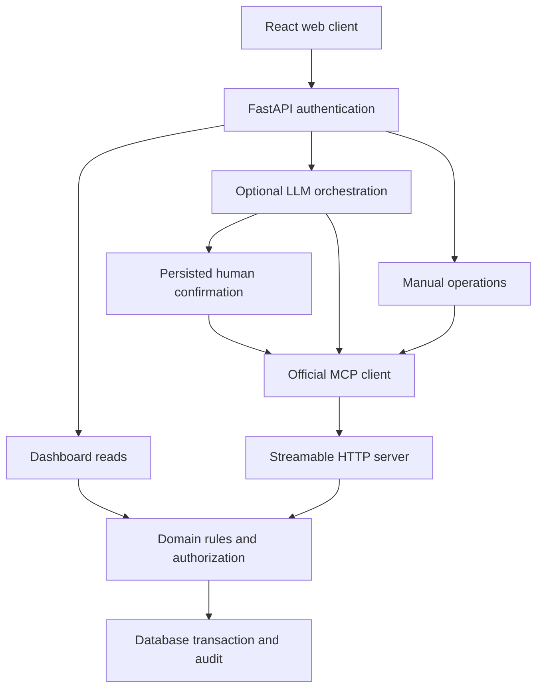

# Architecture

The web client uses one authenticated backend. Read-only dashboard requests use shared domain services directly. Assistant reads and all UI mutations travel through an actual MCP client to the mounted MCP server. Both paths use the same authorization and integrity rules.

The LLM does not receive authority to select an organization or caller. The MCP authentication middleware resolves the caller from a server-verified token, places the user in request-local context, and invokes the domain service. Typed inputs reject unexpected identity/role properties.

Writes validate a per-incident version, execute in a transaction and create an audit entry. A per-user request receipt stores the request fingerprint and response. Identical retries return that result. Reusing a key with a different payload is rejected. SQLAlchemy's version column also detects competing commits.

Handovers contain an immutable snapshot of unresolved case IDs and a designated recipient. The view resolves those IDs to current records, so both snapshot membership and current state are clear. Acknowledgment creates a separate receipt; it never changes incident or control state.

Active controls stay active until an authorized recorded review retires them. An independent supervisor can approve a closure request only after all controls have been retired, ownership accepted and disputes clarified. Verification references are human attestations; software does not verify a physical repair.

SQLite is for local operation. PostgreSQL is the hosted target, using the same schema and migration. This release has been executed against SQLite; production-database behavior remains a validation gate.

Queries for incident lists, history and recent activity are bounded. Integrity and dashboard aggregation currently scan the organization's records; handover snapshots can be large. This is appropriate for the demonstration scale, not evidence of large-scale performance. Before scaling, introduce aggregate queries, paged handover membership tables, retention policies, external rate limiting and workload tests. No Kubernetes, queue system or distributed architecture is needed for the current release.
